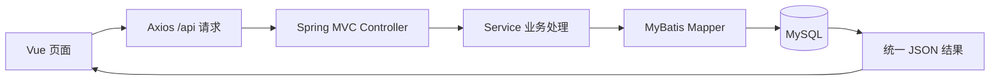

# Tlias 教学管理系统

**Java 后端方向 · Spring Boot / MyBatis / MySQL / Vue 3**

面向培训机构部门、员工、班级和学员管理的学习实践项目，重点练习接口开发、条件查询、多表事务、登录校验和前后端联调。基于黑马 Java Web 的 Tlias 案例整理，在 AI 辅助下完成运行配置、演示数据和项目文档整理。

**快速入口：** [运行步骤](docs/SETUP.md) · [数据库结构与演示数据](database/init.sql) · [请求链路示例](docs/PROJECT_GUIDE.md) · [验证记录](docs/VERIFICATION.md)

## 主要功能

| 模块 | 当前实现 |
| --- | --- |
| 登录 | 用户名密码校验、JWT 生成、请求过滤与前端令牌携带 |
| 部门管理 | 列表、新增、编辑、删除；部门下有员工时限制删除 |
| 员工管理 | 条件筛选、分页、增删改查、工作经历维护 |
| 多表事务 | 员工基本信息与工作经历的保存、更新和删除 |
| 日志与异常 | AOP 操作日志、员工操作日志、统一异常处理 |
| 图片上传 | 阿里云 OSS 接口，需要单独配置自己的存储桶 |

班级管理、学员管理和统计接口已有后端代码；对应前端页面及日志页面目前为标题占位，留作后续练习。

## 一次请求如何完成



可从 [DeptController.java](backend/src/main/java/com/itheima/controller/DeptController.java) 开始阅读部门查询，再沿 Service、Mapper 找到 SQL。员工模块进一步演示分页、多表关系与事务。

## 技术与运行

- Java 17 编译目标，Spring Boot 3.2.10，MyBatis，PageHelper，MySQL 8。
- Vue 3，Vite，Element Plus，Axios。
- 后端使用 Maven；前端使用 npm 和锁定文件。

```powershell
git clone https://github.com/2672232769/tlias-java-showcase.git
cd tlias-java-showcase
```

按 [完整启动步骤](docs/SETUP.md) 创建独立数据库、设置环境变量并分别启动后端和前端。演示登录账号为 `admin / 123456`，仅适用于仓库提供的虚构演示数据。

默认前端地址为 `http://127.0.0.1:5173/login`，后端为 `http://127.0.0.1:8080`。

## 展示与验证范围

2026-10-29，作为本公开副本基线的同版代码已完成后端 Maven 打包与前端 Vite 构建。本公开副本的 Java/Vue 源码、依赖锁定文件和数据库脚本与该基线一致。此次没有重新导入数据库或完成全业务联调；详见 [验证记录](docs/VERIFICATION.md)。

本仓库的作用是展示课程实践、代码结构和后续练习基础。代码实现范围与个人掌握程度分别说明；未把尚未完成的页面或个人改造写成已完成。

## 后续练习

- 部门名称关键词查询，并检查有结果、无结果和空关键词场景。
- 补齐班级、学员页面，完成对应接口联调。
- 完善密码存储、权限校验和业务测试。

## 来源

核心代码与表结构来自黑马 Java Web 的 Tlias 课程案例；原资料保留，公开仓库为单独整理的展示副本。AI 辅助整理内容包括环境变量配置、JWT 密钥读取、相对日志路径、虚构演示数据与说明文档。原课程代码与素材权利归原权利人，本仓库未另行授予开源许可。
